# Chassis STL part catalogue

Visual index of the printable parts for the tank chassis. The STL files live in
this repo (moved 2026-09-27; this note used to point at the old local folder):

```
reference/fpv-rover-v2/
```

The chassis is a heavily modified [FPV-Rover V2.0](https://www.printables.com/model/3150-fpv-rover-v20-tank);
that folder also holds the original model PDF and the Instructables build guide.
For the electronics side of the build see `HARDWARE.md` in FPVTank_Control.

## How to read the images

Each part is rendered three ways in one strip:

| Position | View |
| --- | --- |
| **left** | isometric, from the model's front-left and above (azimuth −55°, elevation 26°) |
| **middle** | isometric, from the model's rear-right and above (azimuth 125°, elevation 26°) |
| **right** | plan view, looking straight down the model's +Z axis |

"Front/left/rear" here mean *the STL's own axes*, not the robot's — every file is
stored in its print orientation, so a part that stands upright on the robot may lie
flat in these views. Dimensions are the raw STL bounding box in millimetres, listed
as **X × Y × Z of the file as saved**, so they are print-bed footprints rather than
installed orientation.

Renders were produced by [`render_stl_views.py`](render_stl_views.py) (numpy-only
software rasteriser, no CAD tool required):

```bash
python chassis-v1/render_stl_views.py reference/fpv-rover-v2 chassis-v1/img
```

> **Resolved 2026-08-03.** `big-bevel-gear-41-v13.stl` and
> `small-bevel-gear-41-v11.stl` were previously noted here as having "disappeared
> from the OneDrive folder". They had not — they live in the
> `alternitive wheel mounts/` subfolder, which the original top-level scan missed.
> Nothing needs recovering. The folder holds 27 STLs across both levels.
>
> See [`used-parts.md`](used-parts.md) for which of these are actually on the robot;
> this file catalogues everything in the source folder, used or not.

## Part summary

| File | Bounding box (mm) | Triangles | Role |
| --- | --- | --- | --- |
| [body-rover-v13](#body-rover-v13) | 207.1 × 50.0 × 110.0 | 20 618 | Main body tub |
| [front-cover-v13](#front-cover-v13) | 24.9 × 24.9 × 89.2 | 19 388 | Body front end cap |
| [rear-cover-v12](#rear-cover-v12) | 24.9 × 24.9 × 93.6 | 10 016 | Body rear end cap (vented) |
| [top-parts-v15](#top-parts-v15) | 150.7 × 125.1 × 15.0 | 19 332 | Vented top deck + small brackets |
| [inner-frame-left-v15](#inner-frame-left-v15) | 207.1 × 40.0 × 50.0 | 50 762 | Left track frame, standard height |
| [inner-frame-right-v15](#inner-frame-right-v15) | 207.1 × 40.0 × 50.0 | 50 762 | Right track frame, standard height |
| [inner-frame-left-high-v10](#inner-frame-left-high-v10) | 207.1 × 65.0 × 48.0 | 105 248 | Left track frame, tall variant |
| [inner-frame-right-high-v10](#inner-frame-right-high-v10) | 207.1 × 65.0 × 48.0 | 104 984 | Right track frame, tall variant |
| [outer-frame-v13](#outer-frame-v13) | 207.1 × 50.0 × 15.8 | 21 832 | Outer track-side plate, carries axles |
| [front-main-cog-v13](#front-main-cog-v13) | 59.5 × 59.5 × 15.0 | 9 546 | 12-tooth front idler sprocket |
| [rear-main-cog-v13](#rear-main-cog-v13) | 59.5 × 59.5 × 21.3 | 9 412 | 12-tooth rear drive sprocket (keyed) |
| [small-cog-v2](#small-cog-v2) | 30.0 × 30.0 × 5.0 | 2 198 | Flanged roller ring (untoothed) |
| [big-bevel-gear-21-v11](#big-bevel-gear-21-v11) | 44.0 × 44.0 × 6.5 | 16 232 | 40-tooth crown gear, 2:1 set |
| [small-bevel-gear-21-v11](#small-bevel-gear-21-v11) | 24.8 × 24.9 × 12.0 | 6 996 | 20-tooth pinion, 2:1 set |
| [big-bevel-gear-41-v13](#big-bevel-gear-41-v13) | 43.8 × 43.8 × 9.4 | 6 166 | 40-tooth crown gear, 4:1 set |
| [small-bevel-gear-41-v11](#small-bevel-gear-41-v11) | 16.2 × 16.2 × 13.2 | 6 550 | ~10-tooth pinion, 4:1 set |
| [track-v13](#track-v13) | 22.4 × 40.0 × 7.3 | 5 388 | Standard track link |
| [big_track_v11](#big_track_v11) | 18.7 × 40.0 × 9.9 | 1 910 | Wide/deep track shoe variant |
| [rubbertrack-v12](#rubbertrack-v12) | 15.6 × 39.4 × 4.3 | 728 | Chevron tread pad (flexible filament) |
| [motor-mount-v13](#motor-mount-v13) | 33.0 × 34.0 × 12.0 | 16 966 | Motor flange + gearbox bracket |
| [esc-mount-left-v12](#esc-mount-left-v12) | 34.6 × 44.2 × 6.4 | 11 068 | Left ESC tray |
| [esc-mount-right-v12](#esc-mount-right-v12) | 34.6 × 44.2 × 6.4 | 11 068 | Right ESC tray (mirrored) |
| [camera-mount-main-v11](#camera-mount-main-v11) | 45.5 × 32.0 × 13.7 | 2 196 | Tilting camera cradle |
| [camera-mount-left-v11](#camera-mount-left-v11) | 26.0 × 17.9 × 3.8 | 1 246 | Camera cradle side plate, left |
| [camera-mount-right-v11](#camera-mount-right-v11) | 26.0 × 18.2 × 3.9 | 896 | Camera cradle side plate, right |
| [led-mount-v12](#led-mount-v12) | 31.0 × 24.5 × 6.3 | 1 976 | Trunnion-mounted headlight disc |
| [tow-bar-plug-v12](#tow-bar-plug-v12) | 11.4 × 12.9 × 5.0 | 986 | Blanking plug for the tow-bar socket |

---

## Body and covers

### body-rover-v13

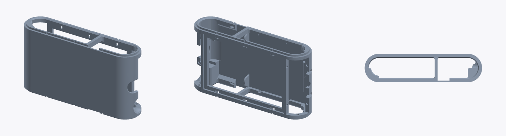

`body-rover-v13.stl` — 207.1 × 50.0 × 110.0 mm, 20 618 triangles

The main electronics tub: a stadium-shaped (rounded-end) shell 207 mm long, printed
lying on its side. Internally it is divided by a full-height cross rib into a large
main bay and a smaller compartment at one end, with screw bosses and ledges along the
top and bottom rims for the deck and end caps. The rounded ends are open — they are
closed by `front-cover-v13` and `rear-cover-v12`. A round-bottomed slot in one end
wall is the pass-through for the tow bar / cable exit.

### front-cover-v13

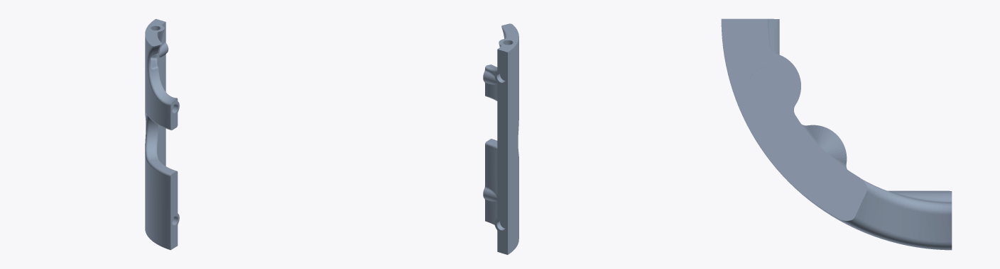

`front-cover-v13.stl` — 24.9 × 24.9 × 89.2 mm, 19 388 triangles

Curved end cap that closes the front of the body. The plan view shows the
quarter-round profile that wraps the body's rounded corner; the panel is 89 mm tall
with integral tabs and screw holes top, middle and bottom, plus a semicircular relief
mid-height. Solid (unvented), unlike the rear cap.

### rear-cover-v12

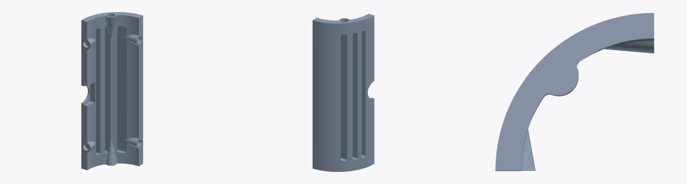

`rear-cover-v12.stl` — 24.9 × 24.9 × 93.6 mm, 10 016 triangles

The rear equivalent: same curved wrap, 93.6 mm tall, but with four long vertical
vent slots down the face and internal stiffening ribs. Screw bosses at top and
bottom, and the same mid-height semicircular notch, which lines up with the
tow-bar socket.

### top-parts-v15

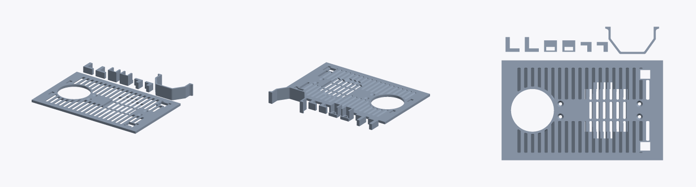

`top-parts-v15.stl` — 150.7 × 125.1 × 15.0 mm, 19 332 triangles

A multi-part print plate, not a single component. The bulk of it is the top deck:
a flat panel covered in cooling slots, with a large circular cut-out at one end
(fan / turret aperture), two rows of wider rectangular openings, and corner screw
holes. Alongside it on the same plate sit half a dozen small brackets, clips and
L-tabs plus one taller curved bracket. Print the whole file, then separate.

## Track frames

### inner-frame-left-v15

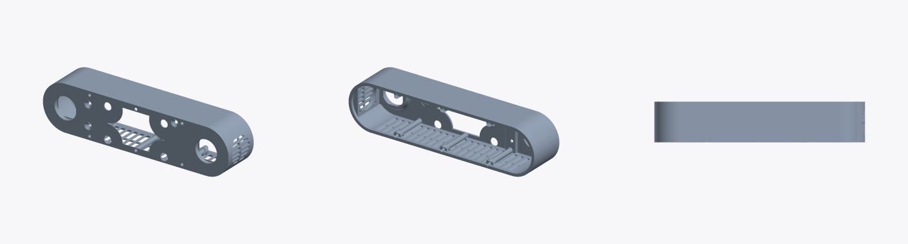

`inner-frame-left-v15.stl` — 207.1 × 40.0 × 50.0 mm, 50 762 triangles

Left-hand track frame: the long stadium-shaped side pod the track wraps around.
The inboard face carries the large drive-shaft bore at one end, an idler bore at
the other, a rectangular access window between them, and a scatter of screw holes
and locating pins. The upper edge is a bank of ventilation slots; a fine-pitch
louvre panel sits at one end.

### inner-frame-right-v15

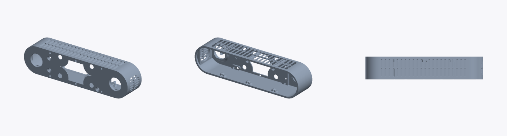

`inner-frame-right-v15.stl` — 207.1 × 40.0 × 50.0 mm, 50 762 triangles

Mirror image of the left frame — identical triangle count and bounding box, different
geometry (the two files are not byte-identical). Note in the plan view that the vent
slots run across the top face on this side.

### inner-frame-left-high-v10

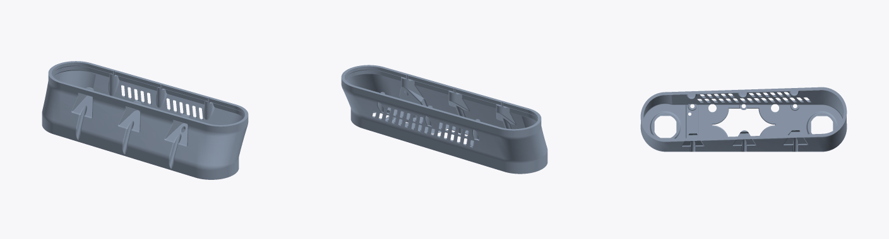

`inner-frame-left-high-v10.stl` — 207.1 × 65.0 × 48.0 mm, 105 248 triangles

The "high" variant of the left frame: same 207 mm footprint but 65 mm wide, forming
a deeper open tub with much more internal volume for batteries and wiring. The outer
wall carries three embossed direction arrows, and there are two banks of vent slots
in the inner wall. Looking straight in, the floor has two large oval axle pockets at
the ends and a lobed cut-out in the middle, with three cross ribs. Roughly twice the
mesh complexity of the standard frame.

### inner-frame-right-high-v10

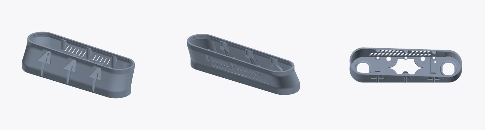

`inner-frame-right-high-v10.stl` — 207.1 × 65.0 × 48.0 mm, 104 984 triangles

Right-hand counterpart of the high frame. Not an exact mirror — the triangle count
differs slightly from the left (104 984 vs 105 248), so the two were edited
independently.

### outer-frame-v13

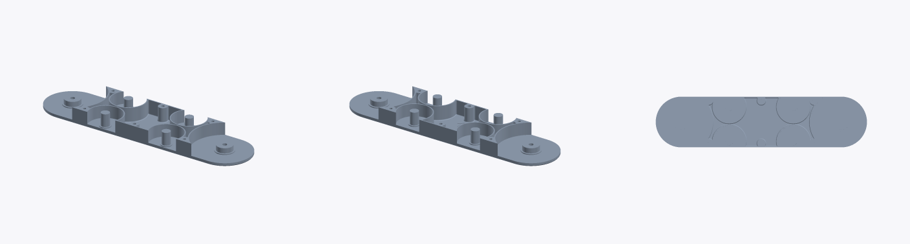

`outer-frame-v13.stl` — 207.1 × 50.0 × 15.8 mm, 21 832 triangles

The outboard plate that closes the track frame from the outside. A flat
stadium-shaped panel with a large raised circular hub pad at each end (the outer
bearing seats for the drive and idler shafts, each with a central bore), and between
them a row of upstanding posts, bosses and shaped webs that space and locate the
frame internals. The outer face is smooth apart from the two hub bosses.

## Drivetrain

### front-main-cog-v13

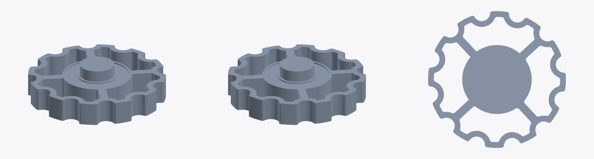

`front-main-cog-v13.stl` — 59.5 × 59.5 × 15.0 mm, 9 546 triangles

Front sprocket, 59.5 mm outside diameter with **12 rounded teeth** and four spokes
running to a broad central hub. The hub is short and round with a plain ~15 mm bore
— an idler that spins freely on its shaft rather than being driven.

### rear-main-cog-v13

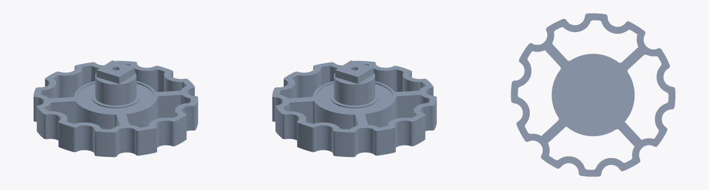

`rear-main-cog-v13.stl` — 59.5 × 59.5 × 21.3 mm, 9 412 triangles

The driven sprocket. Same 59.5 mm, 12-tooth, four-spoke body as the front, but 6 mm
taller because of a tall raised drive boss with a flatted/keyed bore and a small
grub-screw hole — this is the one that locks to the output shaft.

### small-cog-v2

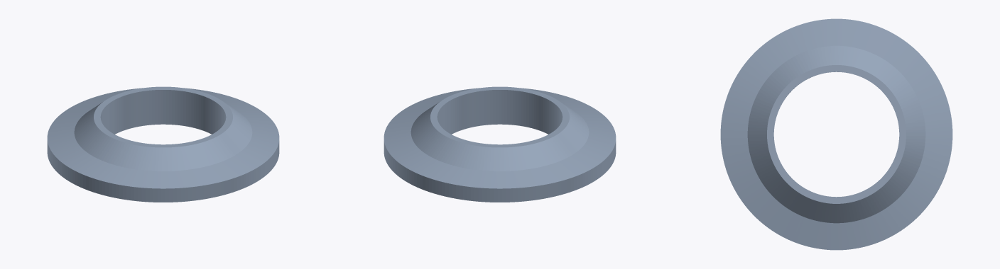

`small-cog-v2.stl` — 30.0 × 30.0 × 5.0 mm, 2 198 triangles

Despite the name, **this part has no teeth**: it is a plain stepped ring, 30 mm
outside diameter and 5 mm thick, with a wide flange and a raised inner boss around
a ~15 mm bore. It works as a road-wheel / track-guide roller or a shaft spacer,
not as a gear.

### big-bevel-gear-21-v11

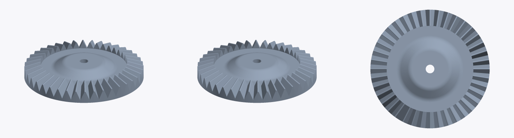

`big-bevel-gear-21-v11.stl` — 44.0 × 44.0 × 6.5 mm, 16 232 triangles

Crown wheel of the 2:1 bevel set: 44 mm diameter, **40 teeth** cut into a shallow
cone around a dished web, with a small central bore. Only 6.5 mm thick — it sits
flat against the gearbox plate and meshes at 90° with the matching pinion.

### small-bevel-gear-21-v11

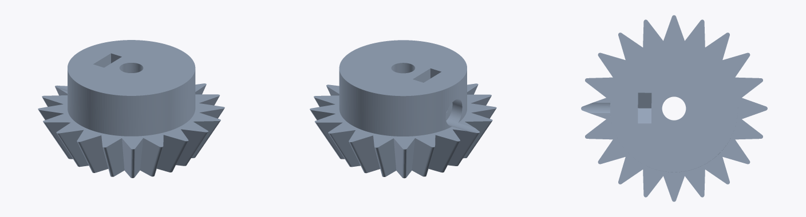

`small-bevel-gear-21-v11.stl` — 24.8 × 24.9 × 12.0 mm, 6 996 triangles

Pinion of the 2:1 set: **20 teeth** on a steep cone under a tall cylindrical hub.
The hub has a central bore, a rectangular key pocket and a cross-drilled grub-screw
hole. 20 teeth against the 40-tooth crown gives the 2:1 reduction the "21" in the
filename refers to.

### big-bevel-gear-41-v13

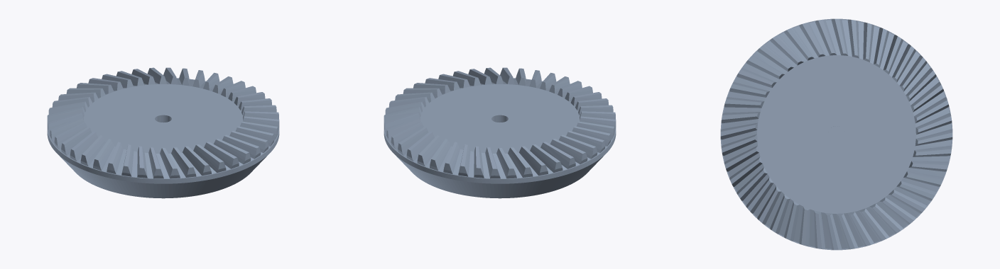

`big-bevel-gear-41-v13.stl` — 43.8 × 43.8 × 9.4 mm, 6 166 triangles

Crown wheel of the 4:1 set: essentially the same 40-tooth, ~44 mm wheel as the 2:1
version but with a taller dished web (9.4 mm) and a coarser mesh. Pairs with the
10-tooth pinion below.

> Source file missing from the STL folder at time of writing — see the note at the
> top of this document.

### small-bevel-gear-41-v11

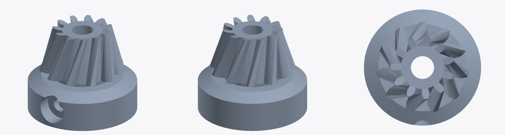

`small-bevel-gear-41-v11.stl` — 16.2 × 16.2 × 13.2 mm, 6 550 triangles

Pinion of the 4:1 set: roughly **10 teeth** on a tall, narrow cone (16.2 mm across,
13.2 mm tall) sitting on a wide cylindrical collar with a cross-drilled grub-screw
boss. Ten teeth into the 40-tooth crown gives the 4:1 reduction — swapping this
pinion for the 20-tooth one is how the gearbox ratio is changed.

> Source file missing from the STL folder at time of writing — see the note at the
> top of this document.

## Track

### track-v13

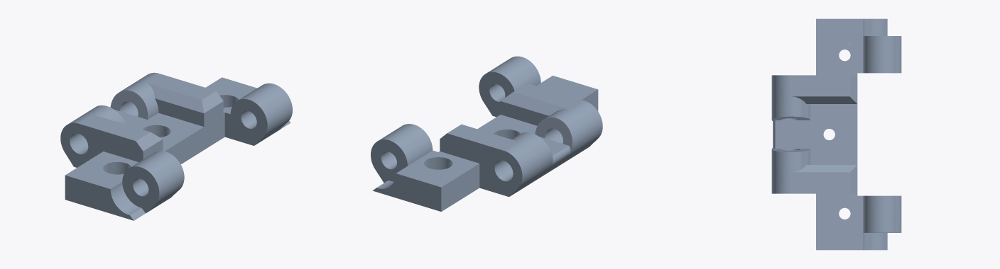

`track-v13.stl` — 22.4 × 40.0 × 7.3 mm, 5 388 triangles

The standard track link, printed one link per file: a 40 mm-wide plate with a pair
of barrel hinge lugs on one edge and a matching single lug on the other, so links
pin together into a continuous belt. A square through-hole in the centre of the
plate takes the sprocket teeth; the hinge bores take the connecting pins.

### big_track_v11

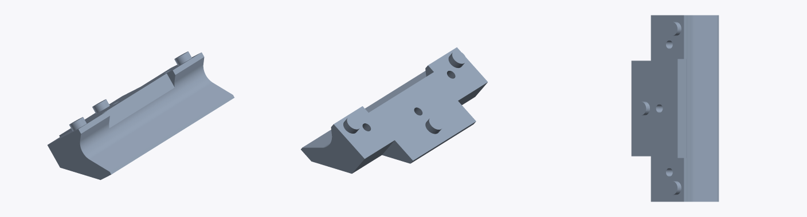

`big_track_v11.stl` — 18.7 × 40.0 × 9.9 mm, 1 910 triangles

A heavier track shoe variant, same 40 mm width but taller in section, with a deeply
scooped concave underside and a chamfered leading edge. Three small studs stand
proud along the top face and there are shallow pin recesses on the flat — it clips
over or replaces the standard link to give a more aggressive grouser profile.

### rubbertrack-v12

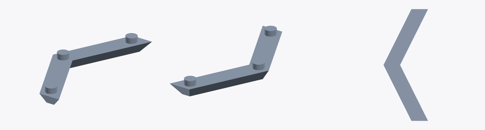

`rubbertrack-v12.stl` — 15.6 × 39.4 × 4.3 mm, 728 triangles

The tread pad, meant for flexible filament: a thin chevron ("V") strip, clearly
visible as a bold `<` in the plan view, with four short cylindrical studs on the
back face that press into the track link. One per link gives the belt its grip.

## Mounts

### motor-mount-v13

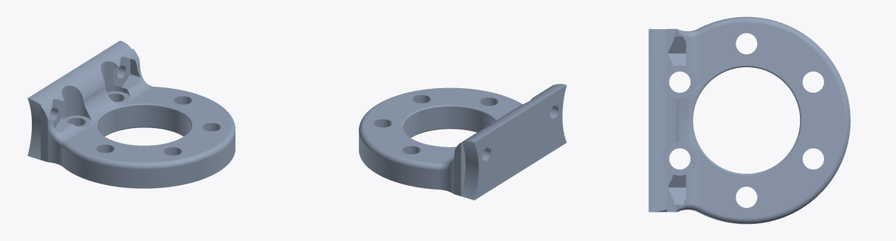

`motor-mount-v13.stl` — 33.0 × 34.0 × 12.0 mm, 16 966 triangles

Motor bracket: a round flange with a large central clearance bore for the motor can
and six equally spaced fixing holes, joined at right angles to a curved upstand that
carries two further screw holes and a pair of internal gussets. The curve on the
upstand matches the track-frame wall it bolts against.

### esc-mount-left-v12

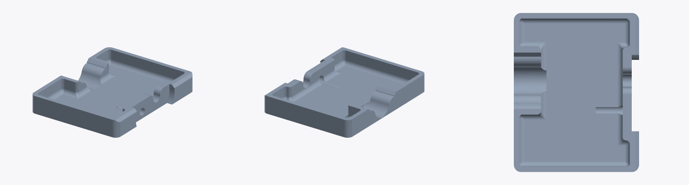

`esc-mount-left-v12.stl` — 34.6 × 44.2 × 6.4 mm, 11 068 triangles

Shallow tray for one ESC: a walled rectangular pocket 34.6 × 44.2 mm with a stepped
notch at one end for the wire loom, a cable slot in the side wall, and small screw
holes and locating ribs in the floor. Only 6.4 mm deep — the ESC drops in and is
strapped or taped down.

### esc-mount-right-v12

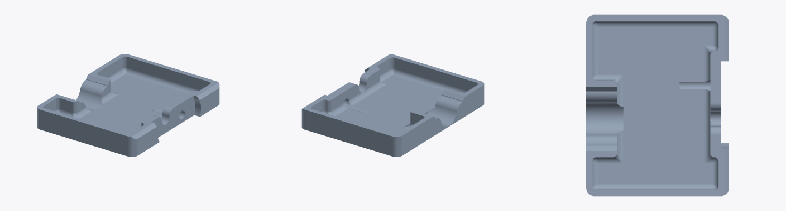

`esc-mount-right-v12.stl` — 34.6 × 44.2 × 6.4 mm, 11 068 triangles

Mirror-image partner to the left tray: identical dimensions and triangle count, with
the wire notch and cable slot flipped to the other side. The two files are distinct
(different checksums), so print each rather than mirroring one twice.

Relevant to this build: the robot is skid-steer with **two** independent
battery + ESC + motor chains (see [HARDWARE.md](../../HARDWARE.md)), so both trays
are used.

### camera-mount-main-v11

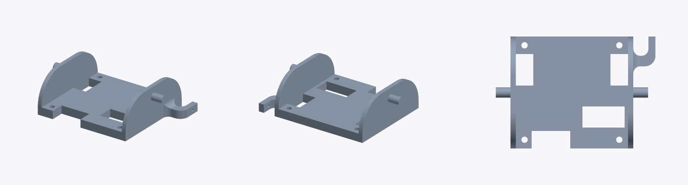

`camera-mount-main-v11.stl` — 45.5 × 32.0 × 13.7 mm, 2 196 triangles

The tilting camera cradle. A flat base with two rectangular slots and four corner
screw holes for the camera board, flanked by two curved upstands. A cylindrical
trunnion pin projects from each side — those are the tilt pivot — and a hooked arm
on one side takes the servo linkage. This is the tilt stage of the pan/tilt head
(tilt runs on PCA9685 channel 5, pan on channel 4).

### camera-mount-left-v11

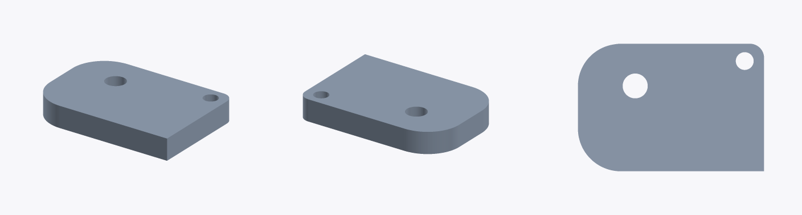

`camera-mount-left-v11.stl` — 26.0 × 17.9 × 3.8 mm, 1 246 triangles

Small 3.8 mm-thick side plate for the camera assembly: a rounded rectangle with one
squared-off edge and two through-holes (one for the trunnion, one for a fixing
screw). Sandwiches against the left side of the cradle.

### camera-mount-right-v11

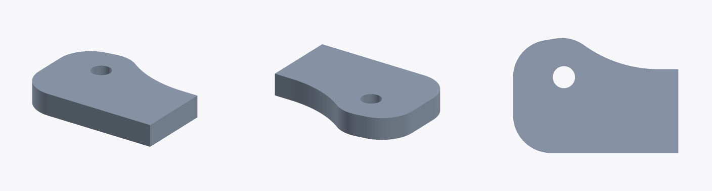

`camera-mount-right-v11.stl` — 26.0 × 18.2 × 3.9 mm, 896 triangles

The right-hand plate. Not a plain mirror of the left one — it has a distinctive
S-curved edge sweeping down from the pivot hole, and only a single through-hole.

### led-mount-v12

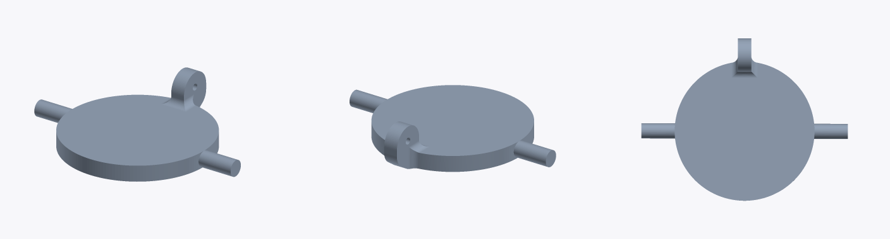

`led-mount-v12.stl` — 31.0 × 24.5 × 6.3 mm, 1 976 triangles

Headlight pod: a 24.5 mm disc, 6.3 mm thick, with a cylindrical trunnion pin
projecting from each side and a small drilled lug on the rim. Pivots between two
uprights so the light can be aimed, with the lug taking a linkage or retaining screw.

### tow-bar-plug-v12

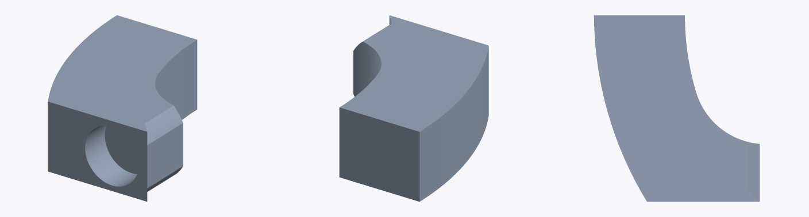

`tow-bar-plug-v12.stl` — 11.4 × 12.9 × 5.0 mm, 986 triangles

Small blanking plug: a wedge with one face curved to match the body's rounded
corner radius and a horizontal through-bore. Fills the tow-bar / cable socket in
the rear cover when nothing is fitted; the bore lets a pin or cable pass if it is.
