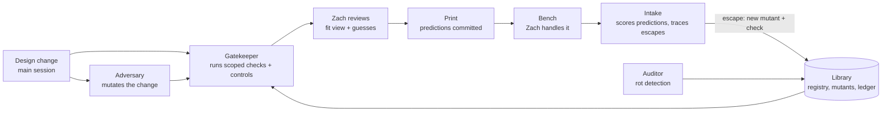

# The check library: checks that can fail, run as everyday work

Draft 1, 2026-10-24. The paper's method (*Checks That Can Fail*, `research/paper/`) turned into the way parts get
designed, gated, printed and learned from here. Status: design and baseline only. Nothing gates a print yet.

**The idea in one line.** Every print is an experiment. Checks predict before it, the bench scores after it, and
every escape (a fault a check should have caught but didn't) becomes a planted fault that every future check must
catch.

## Principles (the defensive baseline)

1. **Fail closed.** A check that can't run, errors, or whose control doesn't fail reads BLOCKED, never PASS.
2. **A check is only as good as its negative control.** Each run also runs the control, and the control must still
   fail. A control that starts passing means the check has rotted, and the gate says so on that run.
3. **The planted-fault set only grows.** Each escape is re-created as a mutant (a deliberately broken copy of the
   design). Mutants are never deleted, so a check can't quietly lose a fault it used to catch.
4. **Something outside judges each check.** The designer doesn't write the mutants that judge its own change.
   Mutants judge the CAD checks, the simulator judges the surrogate, and the bench judges the simulator.
5. **The bench outranks every check.** Physical results overrule sim, sim overrules surrogate, and each overrule is
   logged against the check.
6. **Predict before printing.** What the bench should see is committed before the print starts, so nothing gets fit
   to the result afterwards.
7. **Nothing is deleted.** Checks move between statuses, and every move has a reason and a date (CLAUDE.md's
   History rules).
8. **Scope is explicit.** Every check says what it applies to. Used outside its scope, its result is advisory.
9. **Numbers carry their source.** Every threshold says where it came from: *measured* (caliper), *his model*,
   *datasheet* or *guess*. A gate on a guessed number names the guess.
10. **Stay light.** Add a check only where a real escape or a surviving mutant shows the need. Retire one only on
    evidence.

## The loop

| Agent | When | Reads | Writes | May not |
|---|---|---|---|---|
| **Designer** (main session) | a change is asked for | Zach's model, registry | the change, its guessed numbers, new checks for new features | judge its own change |
| **Adversary** (`.claude/agents/adversary.md`) | every change before the gate | the diff and the registry only, not the designer's reasoning | mutants of what changed; a survivor list | edit the design or any check |
| **Gatekeeper** (`gatekeeper.md`) | before every hand-off or print | registry, the change, mutant results | a gate report, plus predictions for the bench | approve the print (Zach does), or turn BLOCKED into PASS |
| **Intake** (`bench-intake.md`) | session start: "what did the last print show?" | Zach's report, the print's predictions | findings rows, prediction scores, escape traces | edit checks |
| **Auditor** (`auditor.md`) | weekly, and whenever the registry changes | registry, ledger, harness results, logs | a rot report with proposed status moves | delete or retire anything without Zach's OK |

Deterministic work lives in code: the registry, the harness, the control runs, scoring and the integrity audit.
Judgment lives in agents: which checks a new feature needs, what a fault in it would look like, what an escape
says about the checks, and when a check has stopped earning its place.

## A check's life

| Status | Means | To get here |
|---|---|---|
| `proposed` | written, not yet trusted | an escape or a survivor needs it |
| `active` | gates prints | its control fails, the clean design passes, and it kills at least one mutant |
| `legacy` | controlled but never mutation-scored | everything written before the harness (today's baseline) |
| `watch` | flagged by the auditor, still runs | any rot signal below |
| `broken` | missed an escape inside its scope | an escape it should have caught. It stays broken until the escape is a mutant it kills |
| `dormant` | its scope matched nothing for 10 hand-offs | skipped by the gate. It wakes up when its scope matches again |
| `superseded`, `retired` | kept for history, never run | Zach approves, with a reason |

**Two kinds of check.** It's the unit-test vs property-test split:
- **Invariants** say something true of any design: no two parts share solid, every part reaches its seat, every
  screw's way is open. They generalise, and they're what the library is for.
- **Fix guards** pin one fix: set 9's air under the servo block, set 11's merged shelf. They go dormant when the
  feature goes away.
- **Rule of two:** when a second escape shares a guard's cause, generalise the guard into an invariant.

## Rot signals

| Signal | Detected by | Action |
|---|---|---|
| Vacuous: kills no mutant | harness kill count = 0 | `watch`; it can't be `active` |
| Redundant: no unique kill | every mutant it kills, another check also kills | note only. A cheap first look is still worth keeping |
| Weak control: the control reads like the real case | control-vs-design margin under the check's own resolution (C10) | `watch`; redefine the control |
| Noisy: false alarms | the bench overruled it twice with no true catch since (C07, C09) | `watch`; Zach decides whether to narrow its scope |
| Missed: an escape inside its scope | intake traces the escape to it (C11, C13) | `broken` until the escape is a mutant it kills |
| Average hides the tail | a statistical check scored only on average (C15) | must also be scored where decisions are made |
| Few real positives | a pass rate resting on easy cases (H2's gate at 70%: 1 good design in 280) | report the count beside the rate |
| Stale path or input | its runner or inputs moved | BLOCKED (fail closed); fix the path |
| Guessed threshold | a constant with source `guess` | listed in every gate report until measured |
| Dormant | its scope matched no change in 10 hand-offs | `dormant` |

## Requirements

Each one has a test, and each test has a negative control.

- **R1** Every `active` check has a runner, a control and a born-from record. `checks/audit.py` flags any that
  don't. *Control:* `audit.py --control` plants one bad entry of each kind, and each must be flagged.
- **R2** The gate fails closed. A check that errors, is missing, or whose control passes reads BLOCKED.
- **R3** Mutants are append-only. The harness re-run must reproduce the last kill table, the way `regression.py`
  reproduces its own.
- **R4** Every escape gets a findings row (`research/data/iterations_live.csv`). It also gets a check-failure row
  (`check_failures.csv`) when a check passed it, plus a mutant that re-creates it, within the session that logs it.
- **R5** Every hand-off commits its bench predictions (`checks/predictions/`) before the print starts.
- **R6** The adversary works in a fresh context, given the diff and the registry only.
- **R7** A change is gate-ready when every applicable check passes with its control failing, and every mutant of
  the change is killed or accepted by Zach with a reason.
- **R8** Status moves to `retired` or `superseded` need Zach's OK. The reason and the date stay in the registry.
- **R9** Statistical checks report coverage in the decision region and the count of real positives, not only the
  average.
- **R10** Every gate report lists the guessed numbers its verdict rests on.
- **R11** The agents are checks too, so each one gets a backtest. Replay a past change whose bench escape is
  known, and require the agent to find it: the adversary must produce a mutant like it, and intake must trace it to
  the right check. An agent that can't find a known escape isn't trusted on new ones.
- **R12** The auditor *runs* each control. Reading that one exists isn't enough: `insertion`'s registry entry
  listed a `broken` flag the function never uses, and the text-only audit passed it (found 2026-10-24).

## Baseline (2026-10-24)

From `checks/registry.csv`, the harness results and the first `checks/audit.py` run:
- **Mutation-scored:** 10 checks (the pan coil suite), against 22 mutants, 14 of them re-created real failures.
  All 22 are killed and none of the 10 is vacuous. Two checks (`pairs`, `insertion`) have no unique kill. Four are
  fix guards.
- **Controlled but unscored:** 27, covering the head, the bench stand, the chassis-v2 modules, and the simulator
  and surrogate audits. 24 of them are `legacy`; three surrogate checks are on `watch`.
- **Already logged failures of checks:** 15 (C01–C15), 12 of them false passes.
- **The first audit's flags (8):**
  - Two checks have no control: lens clearance (K14) and surrogate gating (K33).
  - Five check failures are cited by no registry check. These are C01, C03 and C06–C08, which became CLAUDE.md
    practices, not checks.
  - One escape is untraced: P05, a tab whose M2 pilot was cut in air. No check reads whether a screw has material
    to thread into. P14 (the snapped stub) is the same cause, so the rule of two says to generalise `screw_threads`
    (K06) into an invariant.
- The audit's control flags 7 of 7 planted faults.

## Backtests

| Date | Agent | Escape | Score | Lesson |
|---|---|---|---|---|
| 2026-10-24 | adversary | P23, the drop-in ring falls out upside down | PARTIAL | Geometric mutants can't see forces, and 8 of 16 bench escapes (P03–P24) are forces; a loads step was added, so the next backtest must use a held-out escape |

Each backtest folder holds the protocol, written before the run; the brief; the result; and the agent's own work.
`checks/backtests/blind.py` builds the blind sandbox, and its leak grep has a control.

## Open for Zach

1. **Where it lives.** Here for now, since the data is here. The paper's "open check library" would eventually be
   its own repo that Prototype and Control both use.
2. **Gate strength.** Should BLOCKED stop a print, or only warn? The proposal: block on fail-closed items and
   unaccepted survivors, and warn on everything else.
3. **The mutation bar.** Every mutant of the change is killed, or accepted by Zach with a reason. Or a number?
4. **Practices in the registry?** CLAUDE.md's Checking rules are checks that people and agents carry out by hand,
   and five logged failures (above) point at them. Should they get registry rows (class `practice`), so the auditor
   can track their escapes too?
5. **First experiments.**
   - **The adversary backtest (R11):** give it the diff of a change whose escape is known, and see whether it finds
     that escape.
   - **The next real hand-off end to end:** adversary, gate, committed predictions, print, then intake.
